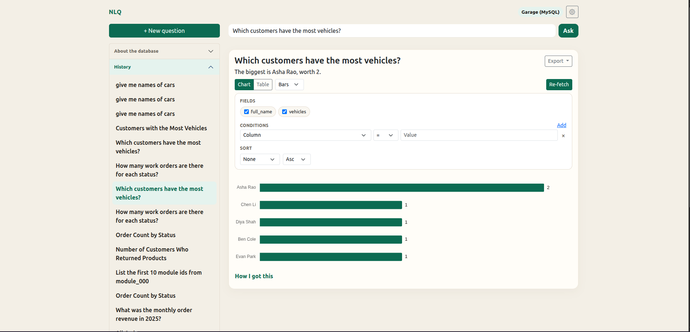
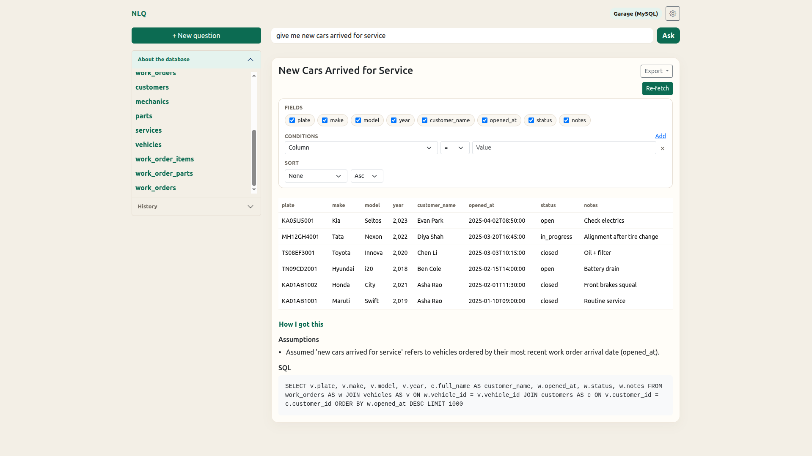
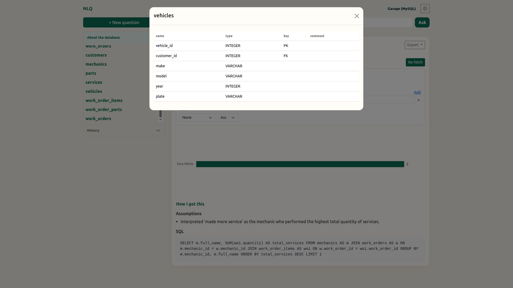
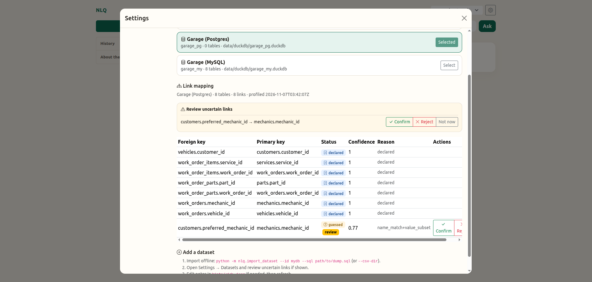
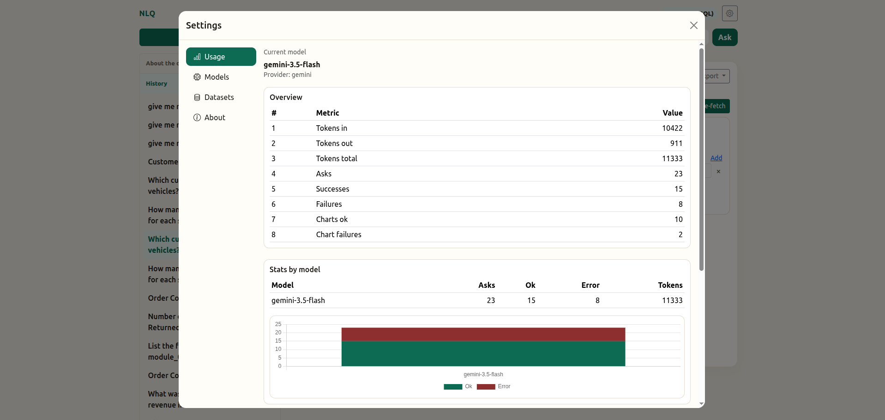
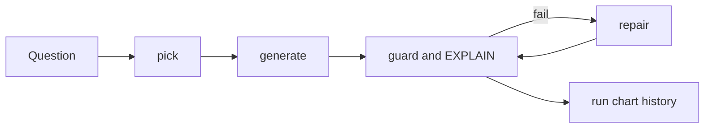
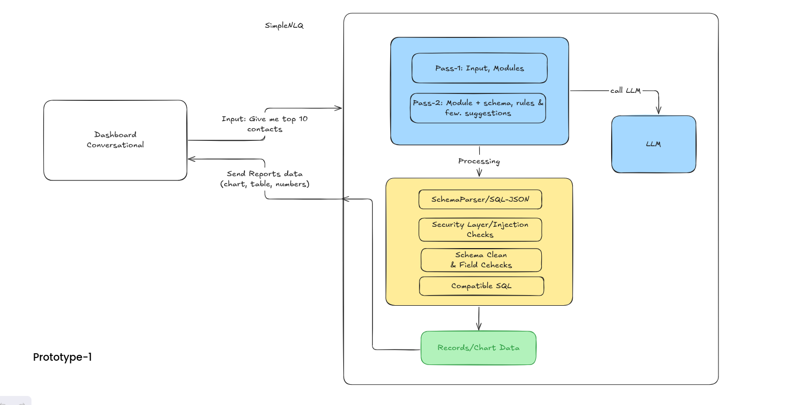

# NLQ

Plain-Text questions in. Reviewable SQL, safe results and charts out.



| | |
| --- | --- |
|  |  |
|  |  |

## Problem

To generate reports takes time & effort in understanding the data and visualize. Useful answers often sit behind SQL skills, hard-to-find schemas and one-off dashboard work. 
Many text-to-SQL demos make things worse. They invent tables, send your data to a model, run unsafe statements, or fail without saying why.

## Solution

NLQ is a local-first analytics workspace. You type a question. It writes DuckDB SQL, checks the query, runs it under strict limits, and shows the answer as a table or chart.

Two rules shape the design:
- You can always see the SQL. Nothing runs in the dark.
- Your result rows never go to the LLM. The model sees the schema and a few sample values, nothing more.

It works with several LLM providers, so you are not locked in.

## Features

- **Ask data in plain English** - get SQL, assumptions, results, and a suitable chart in one report.
- **Transparent by design** - generated SQL is always visible and schema questions are answered directly from the catalog.
- **Safer execution** - read-only DuckDB, single-`SELECT` guard, deny list, `EXPLAIN`, 15-second timeout, and 1000-row cap.
- **Multi-pass generation** - large schemas are narrowed with `pick`; failed queries can self-correct with database-aware `repair`.
- **Bring your own data** - import MySQL/Postgres SQL dumps or CSV directories into isolated DuckDB datasets.
- **Hybrid schema understanding** - combine database metadata, sampled values, declared relationships, inferred links, and human Confirm/Reject review.
- **Charts and tables** - automatic bar, line, pie, and scatter selection, with PNG export for charts.
- **Provider choice** - use OpenAI, Gemini, Claude, or a local OpenAI-compatible Llama/Ollama endpoint.
- **Starter questions without lock-in** - curated or generated recommendations run as stored, validated SQL without another LLM call.
- **History and observability** - reopen reports, configure retention, inspect model usage, and track pick/repair behavior in logs.
- **Local-first deployment** - one Docker start command, localhost-only publishing by default, and no result rows sent to the LLM.

## Example

Question: `How many orders are there for each status?`

```sql
SELECT status, count(*) AS order_count
FROM orders
GROUP BY status
ORDER BY order_count DESC
```

The page shows that SQL, any assumptions, a bar chart or table, and a history entry you can open again.

## How it works



Pick runs only when the schema prompt is large. Generate asks an OpenAI-compatible LLM for JSON with SQL. On failure, repair retries with the database error (up to two times). The database is the wall: one statement, `EXPLAIN`, then a timed run capped at 1000 rows. Result rows never go to the model.

More: [docs/how-it-works.md](docs/how-it-works.md), [docs/adding-data.md](docs/adding-data.md). 

Early sketch: .

## Quick start

1. `cp env.template .env` and set `LLM_PROVIDER` plus that provider's URL, model, and API key.
2. `./bin/start.sh --build` (publishes only `127.0.0.1:8000`).
3. Open http://127.0.0.1:8000 and ask a question (or click Try a question).
4. Optional own data: see [docs/adding-data.md](docs/adding-data.md).
5. `./bin/stop.sh` when finished (history volume `nlq-history` is kept).

## Config

| Variable | Role |
| --- | --- |
| `LLM_PROVIDER` | `openai`, `gemini`, `claude`, or `locallama` |
| `OPENAI_*` / `GEMINI_*` / `CLAUDE_*` / `LOCALLAMA_*` | Base URL, model, API key for that provider. Local Llama key may be empty. Inside Docker use `http://host.docker.internal:11434/v1` for Ollama. |

History retention: Settings → History (default 30 days). Stored in `data/sqlite/settings.json`.

## Safety

- Host bind is localhost via `./bin/start.sh` (`127.0.0.1:8000`).
- Analytics DuckDB is read-only, external access off, memory limit set.
- Guard allows one `SELECT` or `WITH ... SELECT` and blocks words such as `ATTACH`, `COPY`, `read_csv`.
- `EXPLAIN` before run. Query timeout 15s. Row cap 1000.
- LLM sees schema plus curated samples from `hints/<id>.json` only (not live row scans). Result rows never go to the model.

## Limits

- No auth on the HTTP API (rely on localhost bind).
- No live Postgres or MySQL query engine (offline import into DuckDB only).
- No Parquet import CLI yet.
- Valid SQL can still answer the wrong question. The UI always shows the SQL.

## Reference

- [How it works](docs/how-it-works.md) - pick, generate, repair, prompts, and safety
- [Adding data](docs/adding-data.md) - import SQL dumps or CSVs into DuckDB
- [Synthetic E-Commerce Database (Kaggle)](https://www.kaggle.com/datasets/generaterealdata/synthetic-ecommerce-database) - shipped sample under `data/csv/ecommerce/`
- Garage fixtures under `fixtures/garage/` - small synthetic auto-shop dumps for import demos
- [DuckDB](https://duckdb.org/docs/) - analytics engine
- [FastAPI](https://fastapi.tiangolo.com/) - HTTP API
- [Chart.js](https://www.chartjs.org/docs/) - charts in the UI
- [Bootstrap](https://getbootstrap.com/docs/5.3/) - layout and Settings UI
